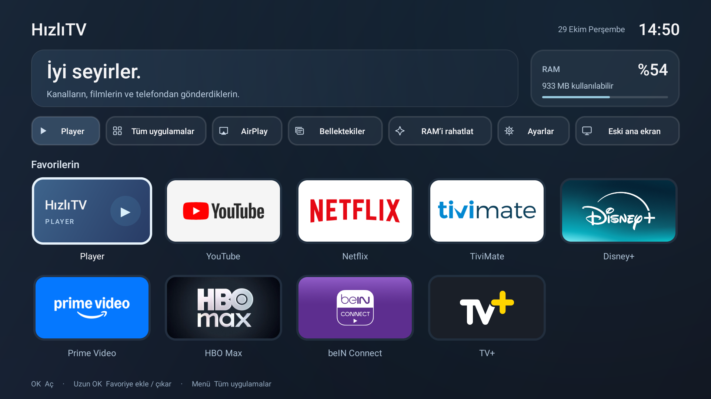

# HızlıTV

Android TV için sade bir ana ekran ve kişisel medya oynatıcısı. Büyük kartlar, net kumanda odağı ve yerel çalışan bir kütüphane. Java ve Android'in yerel View bileşenleriyle geliştirilir; arayüz için WebView, uzak görsel servisi veya sürekli animasyon kullanılmaz.



**Tek APK: HızlıTV 0.8.3** (`tr.hizlitv.home`). Ana ekran, cihaz araçları ve Player aynı uygulamanın içindedir. Player kartı; M3U kanallarını, bağlantıdan video bulmayı, altyazı/ses/kalite seçimini ve telefonla göndermeyi açar. Oynatma motoru yalnız video oynatıldığında oluşturulur.

Android 6 / API 23 ve üzeri TV cihazları hedeflenir. Gerçek cihaz doğrulaması Android 11 çalıştıran Mi TV Stick üzerinde yapılır; diğer üretici/sürüm kombinasyonları ayrıca denenmelidir. Uygulama target SDK 35 kullanır. HOME tuşu veya varsayılan sistem başlatıcısı değiştirilmez. Player ayrı bir uygulama olarak kurulmaz.

## İlk kullanım

1. Derlenen tek APK'yı kendi TV'ne kur. [Adım adım başlangıç](docs/BASLANGIC.md).
2. HızlıTV'yi uygulama listesinden aç. Sağ/sol/yukarı/aşağı ile gezin, OK ile seç. Uzun OK, favoriyi değiştirir.
3. **Player → Telefondan ekle** bölümünden QR'ı okut. Aynı yerel ağdaki telefonundan video bağlantısı veya M3U metni gönder.
4. TV'de **Oynat** veya **Listeyi ekle** seç. Gönderilen bağlantı kendiliğinden oynatılmaz.

QR alıcısı yalnızca Player kütüphane ekranı görünürken çalışır. Arka planda sürekli bir alıcı servisi yoktur. Bu sınırlamayı günlük kullanımda hesaba kat: göndermeden önce Player ekranını aç.

## Geliştirme

JDK 17, Android SDK Platform 35 ve Build Tools 35.0.0 kurulduktan sonra:

```sh
./gradlew :media-core:test :player:testDebugUnitTest
./gradlew :launcher:assembleDebug
```

Windows'ta `gradlew.bat` kullan. APK `launcher/build/outputs/apk/debug/` altında oluşur. `player`, APK üretmeyen bir Android kütüphane modülüdür. Gradle Wrapper projeye dâhildir; ilk çalıştırma internetten araçları ve bağımlılıkları indirir. SDK yolunu Android Studio oluşturabilir veya yerel `local.properties` dosyasında belirtebilirsin. İmzalama anahtarı kaynak dağıtımında bulunmaz.

## Kodun haritası

| Modül | Görevi |
| --- | --- |
| `launcher` | Uygulamaları keşfetme, favoriler, ana ekran ve isteğe bağlı cihaz araçları |
| `player` | Kütüphane akışı, yerel telefon alıcısı, kaynak çözümleme ve Media3 oynatma |
| `media-core` | Android'den bağımsız M3U, URL doğrulama, veri modeli ve filtreleme |
| `tv-ui` | Ortak renkler, tipografi, odak görünümü ve yerel TV bileşenleri |

Player'ın standart HTML çözümleyicisi, siteye özel biçim bağdaştırıcılarından ayrıdır. Yeni bir biçim `SourceAdapter` arayüzüyle eklenir. Ana ekran cihaz IP'sini veya belirli bir stok başlatıcıyı sabitlemez. İsteğe bağlı uygulama paketleri `AppTargets` içinde toplanır.

## Öğrenme rehberi

- [Sıfırdan kurulum, temel kavramlar ve ilk APK](docs/BASLANGIC.md)
- [Mimari: hangi parça neden var, veri nasıl ilerliyor?](docs/MIMARI.md)
- [Görsel tasarım, ölçüler, simgeler ve araştırma referansları](docs/TASARIM.md)
- [Kumandayla günlük kullanım](docs/KULLANIM.md)
- [iPhone QR ve Kestirme kurulumu, sık görülen hatalar](docs/IPHONE.md)
- [M3U listesi hazırlama ve içe aktarma](docs/IPTV.md)
- [Testler ve gerçek cihaz doğrulaması](docs/TEST.md)
- [İzinler, yerel veri ve güvenlik sınırları](SECURITY.md)
- [GitHub'a kaynak yükleme, imzalama ve sürüm hazırlama](docs/YAYINLAMA.md)
- [Eski iki APK’dan kayıtları koruyarak geçiş](docs/GECIS.md)
- [Katkı rehberi](CONTRIBUTING.md)

## Kapsam

Kütüphane, favoriler ve oynatma konumu uygulamanın kendi özel alanında tutulur. Bir önceki kütüphane değişikliği geri alınabilir. Hesap, reklam SDK'sı, kullanım analitiği veya bulut gönderimi bulunmaz. Yayın linkleri, kanal aboneliği veya içerik kataloğu sağlanmaz. Her sitenin oynatıcısı çözülemez; giriş, DRM veya CAPTCHA aşma özelliği yoktur. Yayının içine yerleştirilmiş reklamlar temizlenmez.

AirPlay ayrı, isteğe bağlı bir alıcı uygulamasıyla kullanılır. Bu depoda AirPlay protokolü veya başka bir alıcının APK'sı bulunmaz. Kurulu alıcı ana ekrandan açılabilir. Samsung Legacy/Orsay widget'ı bu Android projesinin parçası değildir.

Özgün kod MIT lisanslıdır. AdbLib'in BSD lisansı ve diğer bağımlılıkların lisansları korunur; [NOTICE](NOTICE) dosyasına bak.
