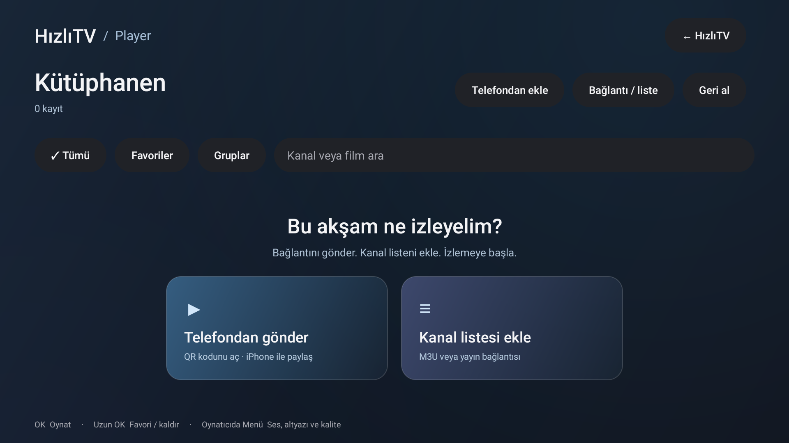

# Kumandayla günlük kullanım

## Ana ekran

HızlıTV'yi TV'nin uygulama listesinden aç. Ana ekran yalnızca favorileri gösterir. Sağ/sol/yukarı/aşağı ile kart seç; beyaz çerçeve hangi kartın seçili olduğunu gösterir. **OK** uygulamayı açar. **Uzun OK** seçili uygulamayı favoriye ekler veya favoriden çıkarır.

Üstteki kısayollar her zaman görünür: **Player, Tüm uygulamalar, AirPlay, Bellektekiler, RAM’i rahatlat, Ayarlar, Eski ana ekran**. Cihaz araçları ayrı bir menünün içine gizlenmez. **Tüm uygulamalar** kurulu TV uygulamalarını gösterir; aynı düğme bu bölümde **Favoriler** olur. **Menü** tuşu da iki görünümü değiştirir. **Geri**, tüm uygulamalardan favorilere, favorilerden önceki ekrana döner. **HOME** sistemin orijinal başlatıcısını açar.

**Player** kartı kişisel kütüphaneyi açar. Diğer kartlar cihazda zaten kurulu uygulamalardır; HızlıTV onların aboneliklerini veya içeriklerini sağlamaz.

## Kütüphane

- **Telefondan ekle:** QR sayfasını açar. Daha önce kurulmuş Kestirme için tekrar QR okutmak gerekmez; kütüphane görünür olsun.
- **Tümü / Favoriler:** kayıtları filtreler. **Gruplar** M3U grubunu seçer.
- **Arama:** kanal veya film adını arar. Türkçe harflerle arama desteklenir.
- Kayıtta **OK:** oynatma onayını açar. Sayfadan eklenen kayıtların geçici video bağlantısı yeniden bulunur.
- Kayıtta **uzun OK:** favori veya kayıt kaldırma seçeneklerini açar.
- **Bağlantı / liste:** elle bağlantı veya M3U girme. **Geri al:** son kütüphane değişikliğini geri alma.
- **← HızlıTV:** aynı uygulamanın ana ekranına dönme. Player için ikinci APK gerekmez.

Kanalları bir kez içe aktarınca listede adlarıyla seçebilirsin. Bir yayın adresi değişirse güncel listeyi yeniden gönder. Şu anda zamanlanmış otomatik liste yenileme veya EPG rehberi yoktur.

Bağlantı gönderince HızlıTV tasarımlı onay penceresi açılır. **Oynat**, **Kütüphaneye ekle** veya **Vazgeç** seçilebilir. Birden fazla kaynak bulunduysa önce kaynak seçilir. Gönderim kendiliğinden oynatmayı veya kaydetmeyi başlatmaz.

## Film oynarken

Video çevresindeki boşluklar siyah gösterilir. OK ile Media3 kontrollerini göster. Kumandanın Menü tuşu kalite, ses dili ve altyazı seçeneklerini açar. Kaynağın sunmadığı seçenek üretilmez. Aynı yayın içindeki desteklenen seçenekler gösterilir. Geri, önce görünen kontrol çubuğunu gizler; sonraki Geri oynatmadan çıkar.

Ses tuşları sistemin medya akışını kontrol eder. TV'nin kendi ses ayarı ile Android TV cihazının medya sesi iki ayrı seviye olabilir. Ses düşükse önce cihazın medya sesini kontrol et. Bu uygulama her açılışta sesi yükseltmez.

## Görünür kısayollar ve bellek

RAM kullanım oranı ana ekranda görünür. Yüksek doluluk tek başına sorun değildir; Android boş RAM'i önbellek için de kullanır.

**Bellekteki uygulamalar**, izinlerin sağladığı ölçümleri gösterir. Süreç varlığı ile o an ekranda açık uygulama aynı şey değildir; RAM ölçümleri Android'in son örneği olabilir. **RAM'i rahatlat** yalnızca kullanıcının isteğiyle uygun arka plan uygulamaları için Android'in izin verdiği isteği gönderir. Android onları tekrar başlatabilir; belirli miktarda bellek kazanımı garanti edilmez.

Seçilen uygulamaları doğrudan durdurma için cihaz içi ADB eşleştirmesi ayrı ve isteğe bağlıdır. Yeni kurulumda otomatik yetkilendirilmez. İzinler ve sınırlamalar [SECURITY.md](../SECURITY.md) içinde açıklanır.

## AirPlay

Ana ekrandaki AirPlay kısayolundan kurulu alıcıyı açabilirsin. iPhone ekran yansıtması o uygulamanın sağladığı özelliklerle çalışır. QR/Kestirme gönderimi, AirPlay ekran yansıtmasından farklıdır: film URL'si gönderilince videoyu Mi Stick kendi oynatıcısında açar; telefon ekranını sürekli aktarmak gerekmez. AirPlay alıcısı bu deponun içinde dağıtılmaz.
