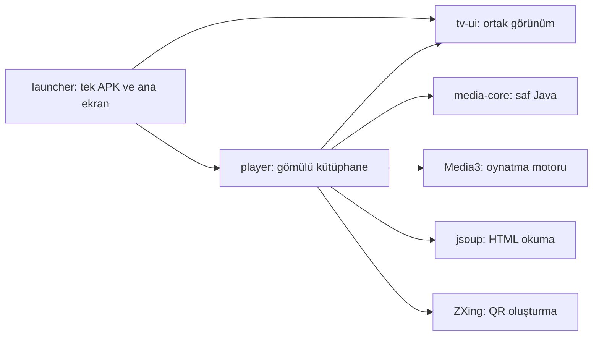
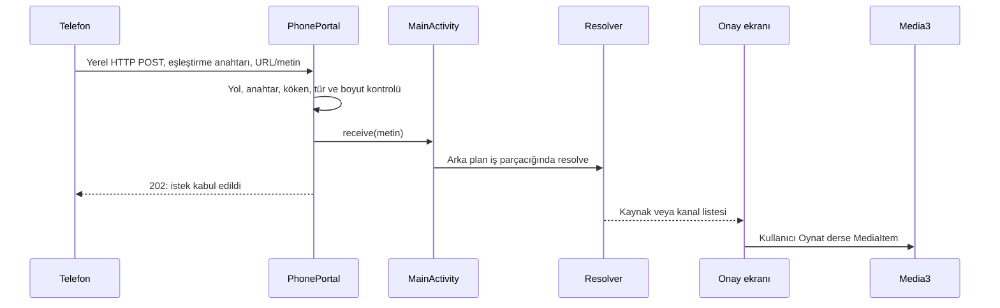

# Mimari ve çalışma mantığı

Uygulamayı dört Gradle modülüne ayırıyoruz. Bir modül, kendi kaynaklarına ve derleme ayarlarına sahip bir kod bölümüdür. Modüller birbirlerine açıkça bağımlı olur; her ekranın tüm işi yapan tek bir dosyaya dönüşmesini önler.



`launcher` uygulama modülüdür; `player` Android kütüphanesine derleme bağımlılığı vardır. Çıktı tek APK’dır. Player ekranları dış uygulamalara kapalı (`exported=false`) Activity’lerdir ve açık Intent ile aynı görev içinde açılır. Media3 APK içinde bulunur ama ExoPlayer nesnesi yalnız oynatma ekranında oluşturulur. `media-core` Android sınıflarına ihtiyaç duymaz; bir URL veya listeyi masaüstü Java testinde de işleyebilir. `tv-ui` bir ürün ekranı içermez; renkler, yazı biçimi ve odaklanabilir düğmeler sunar.

## Ana ekran

| Sınıf | Sorumluluk |
| --- | --- |
| `MainActivity` | Yaşam döngüsü, ekran geçişi, kullanıcı işlemleri |
| `HomeScreen` | Yerleşim, kartlar, seçili uygulama bilgisi ve kumanda odağı |
| `AppCatalog` | PackageManager ile kurulu TV uygulamalarını bulma ve favorileri saklama |
| `AppTargets` | Gömülü Player Intent’i ve isteğe bağlı AirPlay paket kimlikleri |
| `MemoryController` | Ekran görünürken RAM örnekleme ve kullanıcının başlattığı temizlik |
| `AppManagerActivity`, `MemorySnapshot`, `LocalAdb` | İsteğe bağlı tanılama ve seçilen uygulamaları yönetme |

`AppCatalog`, `MAIN + LEANBACK_LAUNCHER` niyetine cevap veren uygulamaları bulur. Android'de **Intent**, bir ekran açma isteğidir; **PackageManager**, kurulu uygulamalarla ilgili bilgiyi sağlar. Uygulamanın banner'ı cihazdan okunur; internetten afiş indirilmez. Sonuçlar kısa süre önbellekte tutulur; paket ekleme/kaldırma/değiştirme bildirimi önbelleği geçersiz kılar. Her geri dönüşte kartlar yeniden oluşturulmaz. Player’ın dahili kartı, eski favori kimliğini korur.

Favoriler `SharedPreferences` içinde paket adlarıyla tutulur. Bir uygulamanın görünen adı değişse de paket kimliği aynıysa favori kaydı devam eder. `AppTargets` içindeki varsayılan liste yalnızca başlangıç önerisidir; bulunmayan uygulama gösterilmez. Orijinal ana ekran için Android'in HOME çözümlemesi kullanılır, üreticiye özgü bir Activity sabitlenmez.

Ana ekranda yedi ayrı işlem kısayolu görünür; bellek araçları tek bir Cihaz menüsüne toplanmaz. RAM özeti küçük bir paneldir.

Kartlar gerçek Android View bileşenleridir. Odak, dokunmatik bir web sayfası taklit edilerek hesaplanmaz. Android'in DPAD gezinmesi ve ScrollView davranışı kullanılır. Görünüm odağa göre değişir; sürekli çizim veya animasyon döngüsü bulunmaz.

## Telefonda gönder düğmesine basınca



**202, filmin mutlaka oynadığı anlamına gelmez.** Alıcının isteği kabul ettiğini belirtir. Kaynak incelemesi ve TV onayı daha sonra gerçekleşir. Film sunucusu hata verirse TV'de gerçek hata gösterilir.

`PhoneCompanion`, eşleştirme anahtarını, QR penceresini ve HTTP dinleyicisinin ömrünü yönetir. Anahtar ilk eşleştirmede rastgele üretilir ve uygulamanın özel alanında tutulur. Anahtar hem URL yolunda hem POST başlığında doğrulanır. Android güncellemesi aynı imzayla yapılınca mevcut eşleştirme korunur.

`PhonePortal` küçük, sınırlı bir yerel HTTP sunucusudur. Dış dosya okuma, komut çalıştırma veya genel proxy uç noktası sunmaz. İki işçi, sınırlı istek kuyruğu, zaman aşımı ve gövde boyutu sınırı kullanır. HTTPS sunucusu değildir. Ortak bir ağı güvenli bir tünel hâline getirmez.

Alıcı yalnızca kütüphane görünürken açıktır. `onStart`, eşleşmiş alıcıyı başlatır; `onStop` kapatır. Bu, pil/servis/arka plan karmaşıklığını azaltır. Beklerken ekranın uyumasını pencereye ait `KEEP_SCREEN_ON` bayrağı önler; uygulamadan çıkınca bayrak temizlenir.

## Video veya liste nasıl bulunuyor?

`Resolver` üç giriş türüyle başlar:

1. `#EXTM3U` / `#EXTINF` ile başlayan metin: `media-core/M3u` kanal kayıtlarına çevirir.
2. Doğrudan medya URL'si: uygun türle oynatılacak kaynak olarak ele alınır. HLS bağlantısı önce okunur; bir kanal listesiyle karıştırılmaz.
3. HTML sayfası: jsoup ile `video`, `source`, `track`, uygun meta etiketleri ve sınırlı iframe'ler okunur.

Sınırlar: en fazla 2 MB sayfa/liste, altı sayfa, iki iframe katmanı, yaklaşık 30 saniyelik çözümleme bütçesi. Ayrı HTTP bağlantı/okuma zaman aşımları da bulunur; engellenen bir ağ işlemi bütçenin üstüne kısa süre taşabilir. JavaScript değerlendirilmez; reklam betikleri ve takip kodları indirilmez. Her site bu yöntemle çözülemez.

HTML dışı özel bir kaynak biçimi gerekiyorsa `SourceAdapter` kullanılır. `SourceAdapters.defaults()` isteğe bağlı bağdaştırıcıları kaydeder. Standart HTML çözümü, boş bir bağdaştırıcı listesiyle de çalışır. Paket içindeki eski Close biçimi bağdaştırıcısı yalnızca tanımlı ana makine ve gözlenen biçimde çalışır; genel bir şifre çözme veya DRM sistemi değildir.

Yeni bağdaştırıcı örneği:

```java
final class ExampleAdapter implements SourceAdapter {
    public boolean supports(String host) { return host.equals("video.example.org"); }
    public String extract(String html, String host) {
        // Yalnızca tanımlı veri biçimini oku. Bulamazsan boş değer döndür.
        return "";
    }
}
```

Bu örnek ağ isteği yapmaz. Bağdaştırıcıyı registry'ye ekle ve kendi ürettiğin, hesap/anahtar içermeyen bir fixture ile test et. UI, HTTP alıcısı ve oynatma motoru değişmemelidir. Oturum, CAPTCHA veya DRM gibi erişim gereksinimlerini aşmaya çalışmak yerine desteklenmeyen kaynak hatası döndür.

## Kayıt ve oynatma

`MediaEntry`, başlık, URL, grup ve altyazı bilgilerini taşır. Ses ve kalite seçenekleri oynatma sırasında akıştan okunur. `LibraryRepository`, tek sıralı işçide dosya okuma/yazma, geri alma ve indekslemeyi yürütür; UI sonuçları ana iş parçacığında alır. `LibraryIndex`, Türkçe başlıkları her kayıt anlık görüntüsünde bir kez normalize eder. Arama 150 ms gecikmeyle filtrelenir. `ListView` satırları yeniden kullanır; 5000 kayıt için 5000 View oluşturulmaz. `LibraryQuery` eski saf filtreleme API’sini korur. `LibraryScreen` veriyi listeler; dosya yazmaz ve kaynak çözümlemez.

`LegacyMigration`, eski iki uygulamalı kurulum varsa telefon alıcısını başlatmadan önce kayıtları aktarır. İmzalı geçiş köprüsü ve özel yedek için [Geçiş rehberine](GECIS.md) bak.

`Store`, uygulamanın özel alanına `AtomicFile` ile yazar. Atomik yazma, yarım kalmış bir kayıt yüzünden mevcut kütüphanenin kaybolmasını önlemeye yardımcı olur. Her değişiklikten önce bir önceki sürüm tutulur; geri alma tek seviyelidir. En fazla 5000 kayıt ve 8 MB kütüphane sınırı vardır. Yayın URL'si hesap bilgisi içerebileceği için kütüphane herkese açık loga aktarılmaz.

`PlayerActivity`, Media3 ExoPlayer'a `MediaItem` verir. Media3 akışı indirir, tamponlar ve Android'in codec/donanım yolunu kullanır. Ayrı bir video dönüştürme sunucusu yoktur. Varsayılan video üst sınırı 1920×1080; ses ve altyazıda Türkçe tercih edilir. Kaynağın gerçekten sunduğu desteklenen seçenekler Menü'den seçilebilir.

Oynatma ekranı kapanınca motor serbest bırakılır, VOD konumu saklanır. Canlı yayın konumu saklanmaz. Sistem medya sesi uygulama açılırken zorla değiştirilmez. Kaynakların ses yüksekliği değişebilir; telefonla eşitleme yapan ayrı AirPlay alıcısı sistem sesini etkileyebilir.

## Genişletirken hangi dosyaya dokunmalı?

- Kart boyutu / yerleşim: `HomeScreen`; ortak düğme / renk: `TvUi`.
- Yeni uygulama entegrasyonu: `AppTargets`; uygulama keşfi: `AppCatalog`.
- Liste ayrıştırma veya URL kuralları: `media-core`; saf Java testleri ekle.
- Yeni kaynak biçimi: `SourceAdapter` ve test fixture'ı.
- Telefon aktarım protokolü: `PhonePortal` ve socket testleri; eşleştirmeyi bozacak değişikliğe geçiş planı ekle.
- Oynatma politikası: `PlayerActivity`; codec ve altyazıyı gerçek cihazda kontrol et.

Genel kod, cihaz IP'sini veya kullanıcının kanal listesini bilmemelidir. Cihazdan alınan günlük/yedekler bu deponun parçası değildir.
