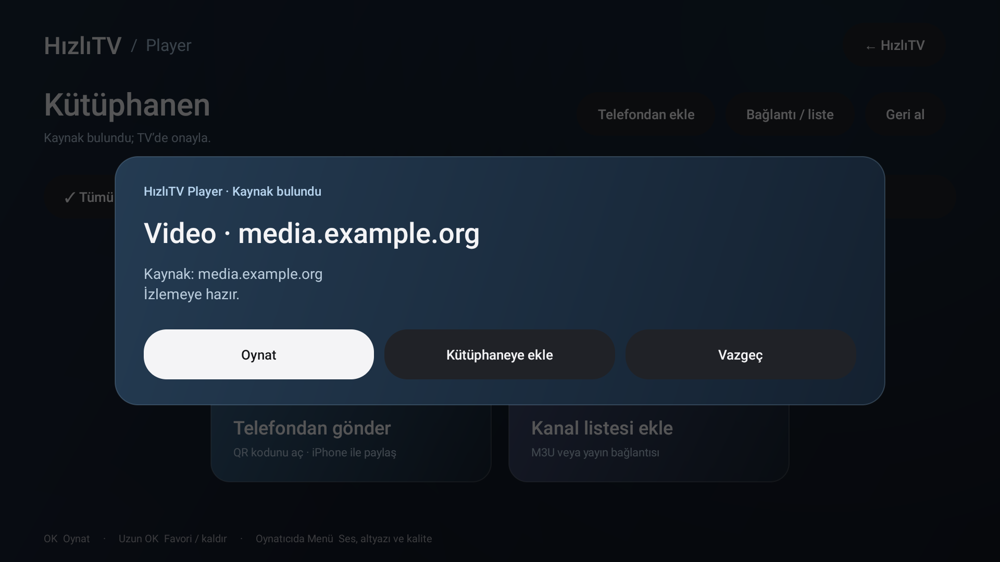

# Görsel tasarımın mantığı

HızlıTV'nin ana ekranı, büyük uygulama kartlarını ve açık bir kumanda odağını temel alır. Apple TV'nin görünüm kılavuzundaki büyük ikon düzeni ve Android TV'nin DPAD ilkeleri referanstır. Apple görselleri, yazı tipi dosyaları veya ürün kodu kopyalanmaz.

## Yerleşim

1. Küçük başlık, tarih ve saat.
2. Seçili uygulama bilgisi ile sürekli görünen kompakt RAM paneli.
3. **Yedi ayrı kısayol:** Player, Tüm uygulamalar, AirPlay, Bellektekiler, RAM'i rahatlat, Ayarlar, Eski ana ekran.
4. Beş sütunlu uygulama kartları. Çok sayıda uygulama dikey kaydırılır.
5. Kumanda kullanımı için kısa alt açıklama.

Bellek ve diğer araçlar tek bir Cihaz menüsüne gizlenmez. Bu, kullanım testinden gelen bir tercihtir: kullanıcı, sık kullandığı araçlara doğrudan ulaşmak istedi. Sadelik, gereken düğmeleri kaldırmak yerine yazı boyutunu, boşluğu ve görsel ağırlığı dengeleyerek sağlanır.

## Teknik uygulama

`AmbientBackground`, birkaç önbelleklenmiş LinearGradient/RadialGradient shader'ıyla statik arka plan çizer. Bitmap, video arka planı, gerçek zamanlı bulanıklık veya sürekli kare döngüsü yoktur. `ActionIcon`, kendi çizdiğimiz küçük vektör simgeleri üretir. Kartlar cihazdaki kurulu uygulamaların banner'larını kullanır.

Seçili kart açık çerçeve, hafif ölçek artışı ve etiket vurgusuyla ayırt edilir. Gezinme gerçek Android View odağını kullanır. Bu görünümü değiştirirken seçili öğenin her arka plan ve banner üzerinde okunabildiğini TV'de kontrol et.

Renk ve ortak bileşenler `tv-ui`, ana ekranın ölçüleri `HomeScreen`, işlem kimlikleri `HomeAction` içindedir. Bir düğmenin görsel sırası değişse de işlemi dizi indeksine bağlı değildir. Arka plan ve düğme bileşenleri ağ, kayıt veya oynatma mantığını bilmez.

## Referanslar

- [Apple TV görünüm ve büyük ikon düzeni](https://support.apple.com/en-nz/guide/tv/atvb46af4f11/26/tvos/26)
- [Apple: Designing for tvOS](https://developer.apple.com/design/human-interface-guidelines/designing-for-tvos)
- [Android TV: gezinme ve odak](https://developer.android.com/training/tv/get-started/navigation)

## Gömülü Player

Player aynı statik arka planı, yazı ölçülerini ve beyaz odak çerçevesini kullanır. Telefondan ekle, bağlantı/liste ve geri alma görünür kalır. Boş kütüphanede iki büyük kart, QR ile gönderme ve kanal listesi ekleme işlerini anlatır. Başlıktaki HızlıTV düğmesi aynı APK içindeki ana ekrana döner. Video gösterilmedikçe decoder/tampon oluşturulmaz.

Odak çerçeveleri bir kez oluşturulup `StateListDrawable` ile seçilir; her tuşta yeni şekil üretilmez. Ağır dinamik gölge kullanılmaz. Kare ölçümleri cihazda yapılır; 60 fps her cihazda garanti edilmez.

## Bağlantı sonrası pencereler

Kaynak onayı, kanal listesi onayı, birden fazla kaynak seçimi ve bağlantı hatası `tv-ui/TvDialog` bileşenini kullanır. Koyu mavi panel, ortak yazı biçimi ve beyaz odaklı düğmeler ana ekranla aynı görsel dili taşır. İlk işlem otomatik odaklanır; yön tuşlarıyla diğer işlemlere geçilir. Kaynak seçimi listesi satırları yeniden kullanır; animasyon, WebView veya uzak görsel servisi yoktur. Activity görünmez olunca pencere kapatılır.

Film oynatırken pencere, video çevresi ve yükleme arka planı siyahtır. Görüntü kırpılmadan kendi oranında gösterilir. Bu tema yalnız oynatma Activity’sine uygulanır.
