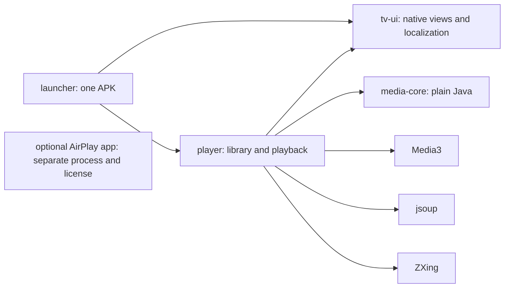
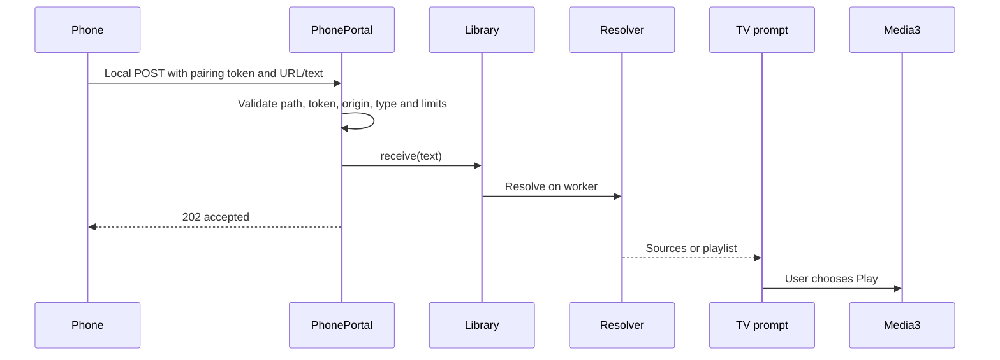

# Architecture and data flow

[English](ARCHITECTURE.md) · [Türkçe](../MIMARI.md)

The app is split into modules so UI, network parsing, storage and playback can change independently. Only `launcher` is the normal Android application module; `player` is an Android library embedded in its APK.



The Player activities are internal (`exported=false`) and open with explicit intents. Media3 classes are packaged with the app, but the ExoPlayer instance/decoder/buffers are created only in the playback Activity. An optional GPL receiver lives in a pinned Git submodule and is launched as a separate installed app; it is not linked into this graph.

## Dashboard

| Class | Responsibility |
| --- | --- |
| `MainActivity` | Lifecycle, actions and navigation |
| `HomeScreen`, `HomeAction`, `ActionIcon` | Layout, stable action identities, vector icons and real DPAD focus |
| `AppCatalog` | Discover TV apps through PackageManager and store favorite package IDs |
| `AppTargets` | Internal Player intent and optional external integrations |
| `MemoryController` | Foreground RAM sampling and explicit audited cleanup requests |
| `AppManagerActivity`, `MemorySnapshot`, `LocalAdb` | Optional diagnostics and selected-app closure |

An Intent requests an operation/screen. PackageManager finds apps responding to `MAIN + LEANBACK_LAUNCHER`. Banners are read from installed packages, not a remote artwork service. App discovery is cached briefly and invalidated by package changes; unchanged cards are not recreated on every return.

Favorites use package IDs in private SharedPreferences. The embedded Player retains its former logical favorite ID for migration compatibility. Stock HOME is resolved through Android rather than a hardcoded vendor Activity.

## Phone to player



HTTP202 means accepted, not that a film is already playing. The TV still resolves and asks the user to choose an action. Resolution errors are shown rather than replaced with invented playable URLs.

`PhoneCompanion` owns pairing preferences, QR presentation and the listener lifecycle. A random token and port are preserved through matching-signed updates. `PhonePortal` provides a bounded local server: two workers, a limited queue, body/header limits and timeouts. It has no file/command/proxy endpoint or CORS interface. Token/path checks and same-origin validation protect its narrow API. It uses local HTTP, not a private encrypted tunnel.

The listener starts only while the library is visible and stops in `onStop`. It also stops during video playback. `KEEP_SCREEN_ON` is scoped to the receiving screen. `PhonePage` handles English/Turkish phone text and language negotiation independently of Android resources; changing page language does not change pairing.

## Source resolution

`Resolver` accepts M3U text, direct media URLs, or HTML pages. It distinguishes HLS media manifests from channel playlists by content, not just file extension. jsoup reads supported `video`, `source`, `track`, metadata and iframe elements. Arbitrary JavaScript is not evaluated; ad scripts are not fetched for UI rendering.

Limits include 2 MB pages/lists, six fetched pages, two iframe levels and an approximate 30-second discovery budget plus network timeouts. Not all sites can be resolved. Authentication, CAPTCHA and DRM bypass are outside scope.

Site-specific formats implement `SourceAdapter`; `SourceAdapters.defaults()` registers the optional adapters. The generic resolver works with an empty adapter list. The observed Close-format adapter is isolated and only recognizes its declared hosts/format; it is not a universal decryption service.

```java
final class ExampleAdapter implements SourceAdapter {
    public boolean supports(String host) { return host.equals("video.example.org"); }
    public String extract(String html, String host) { return ""; }
}
```

Test new adapters with synthetic fixtures and no account data. They should not require UI/storage/engine changes.

## Library, playback and language

`MediaEntry` carries a title, URL, group, source page and subtitle tracks. Source metadata is kept as supplied; user titles are not translated. `LibraryRepository` serializes disk operations and indexing on one worker. `Store` writes private JSON with AtomicFile and a one-level undo snapshot, capped at 5000 entries / 8 MB. `LibraryIndex` pre-normalizes searchable titles and handles English/Turkish capitalization. Search is debounced; ListView reuses rows.

`PlayerActivity` supplies a MediaItem to Media3, which uses Android's codec/hardware path. It prefers the UI language for audio/text, defaults to a 1920×1080 video limit, and exposes only available supported tracks. VOD position keys are URL hashes; live playback positions are not resumed. The engine is released on stop. No system volume is forced on app startup.

`LocalizedActivity` wraps the app context with a supported locale. `Language` reads an app-only preference and recreates the Activity on selection. English resources are the base, Turkish overrides live in `values-tr`. `I18n` translates known domain errors at the UI boundary while parsers remain plain Java. `TvDialog` knows only presentation and supplied callbacks; the library Activity owns/dismisses the active source prompt.

`LegacyMigration` runs on the repository worker before opening the phone listener. It validates a same-signer snapshot and preserves pairing/positions; see [migration](MIGRATION.md).

## Where to change things

- Layout/cards: `HomeScreen` or `LibraryScreen`; common styles/dialogs: `tv-ui`.
- App discovery/integration: `AppCatalog` / `AppTargets`.
- Playlist/URL/index rules: `media-core`, with plain-Java tests.
- Source formats: adapters and synthetic fixtures.
- Phone protocol: `PhonePortal`, with socket tests and pairing compatibility.
- Track/buffer policy: `PlayerActivity`, verified on actual hardware.
- Translations: English/Turkish resource pairs and the phone-page catalog.
