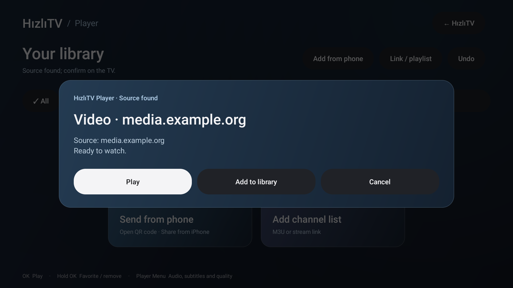

# Design

[English](DESIGN.md) · [Türkçe](../TASARIM.md)

The interface uses large TV cards, restrained blue/slate surfaces and a clear white focus indicator. Apple TV's spacious icon arrangement and Android TV's DPAD rules are references; Apple assets, fonts and product code are not copied.

## Dashboard

The top row contains the brand, app-language choice, date and clock. A compact greeting/selected-app panel sits beside the RAM summary. Seven separate shortcuts remain visible: Player, All apps, AirPlay, Apps in memory, Free memory, Settings and Stock home. Device tools are not hidden inside a combined category. A five-column card grid scrolls vertically when needed.

`AmbientBackground` caches a few gradient shaders. There are no bitmap/video backgrounds, real-time blur or continuous animation loops. `ActionIcon` draws original vector icons. Installed-app banners come from the device. Focus frames are allocated once and switched with StateListDrawable; dynamic focus shadows are avoided. Focus uses real Android Views rather than a web imitation of keyboard navigation.

## Embedded Player

The library shares the dashboard's visual language. Add from phone, Link/playlist and Undo stay visible. Two large empty-state cards explain phone sharing and channel import. The HızlıTV button returns within the same APK. Search/filtering does not allocate a View per library entry.

`TvDialog` gives incoming source, playlist, source-choice and error prompts the same panel/buttons/focus style. First action/row focus is explicit, and TV confirm keys select a source with one OK even on devices that otherwise only restore list selection. The Activity dismisses its prompt when leaving the screen.

The playback window, uncovered video area and loading shutter are black. Video retains its aspect ratio rather than being stretched/cropped to hide bars.

## Localization and performance

English and Turkish use the same layouts and fonts. Labels should fit at TV viewing distance; check both languages after editing. System/English/Turkish selection changes only the app locale. Test long titles, search results and focus after returning from another screen.

Reduced drawing work is not a universal 60 FPS guarantee. Measure on real hardware and describe samples honestly; see [testing](TESTING.md).

References: [Apple TV appearance](https://support.apple.com/en-nz/guide/tv/atvb46af4f11/26/tvos/26), [tvOS design](https://developer.apple.com/design/human-interface-guidelines/designing-for-tvos), [Android TV navigation](https://developer.android.com/training/tv/get-started/navigation).
