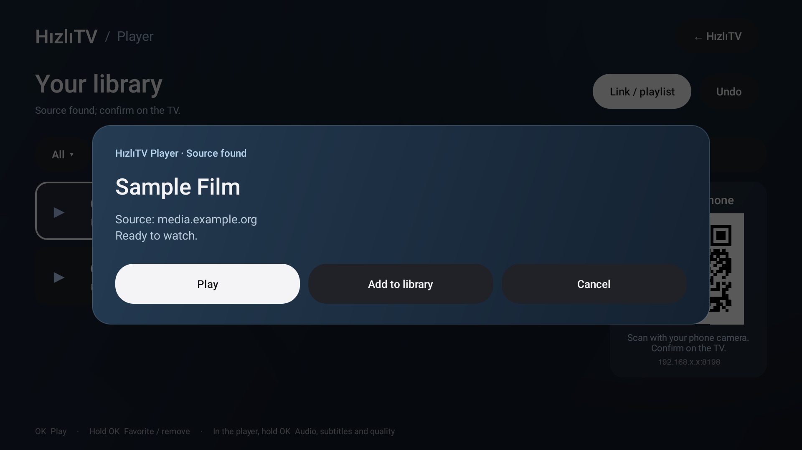

# Design

[English](DESIGN.md) · [Türkçe](../TASARIM.md)

The interface uses large TV cards, restrained blue/slate surfaces and a clear white focus indicator. Apple TV's spacious icon arrangement and Android TV's DPAD rules are references; Apple assets, fonts and product code are not copied.

## Dashboard

The top row contains the brand, four round tool icons (AirPlay, Memory, Settings, Stock home), app-language choice, date and clock. Each tool stays one press away; its name appears in the greeting panel while focused instead of as a permanent label. The wide greeting panel describes the focused card or tool and carries a quiet RAM summary. Below it, a five-column favorites shelf (Player first) and the full app grid share one vertically scrolling screen, so there is no separate All apps mode. Free memory moved into the Memory screen beside the process list.

`AmbientBackground` caches a few gradient shaders. There are no bitmap/video backgrounds, real-time blur or continuous animation loops. `ActionIcon` draws original vector icons. Installed-app banners come from the device. Focus frames are allocated once and switched with StateListDrawable; dynamic focus shadows are avoided. Focus uses real Android Views rather than a web imitation of keyboard navigation.

## Embedded Player

The library shares the dashboard's visual language. A fixed panel beside the list shows the pairing QR code, so sending from a phone needs no extra dialog. Link/playlist stays visible; Undo appears only while a backup exists. One Show button replaces separate All/Favorites/Groups buttons. The empty state points to the QR panel and offers one channel-import card. The HızlıTV button returns within the same APK. Search/filtering does not allocate a View per library entry.

`TvDialog` gives incoming source, playlist, source-choice and error prompts the same panel/buttons/focus style. First action/row focus is explicit, and TV confirm keys select a source with one OK even on devices that otherwise only restore list selection. The Activity dismisses its prompt when leaving the screen.

The playback window, uncovered video area and loading shutter are black. Video retains its aspect ratio rather than being stretched/cropped to hide bars.

## Localization and performance

English and Turkish use the same layouts and fonts. Labels should fit at TV viewing distance; check both languages after editing. System/English/Turkish selection changes only the app locale. Test long titles, search results and focus after returning from another screen.

Reduced drawing work is not a universal 60 FPS guarantee. Measure on real hardware and describe samples honestly; see [testing](TESTING.md).

References: [Apple TV appearance](https://support.apple.com/en-nz/guide/tv/atvb46af4f11/26/tvos/26), [tvOS design](https://developer.apple.com/design/human-interface-guidelines/designing-for-tvos), [Android TV navigation](https://developer.android.com/training/tv/get-started/navigation).
