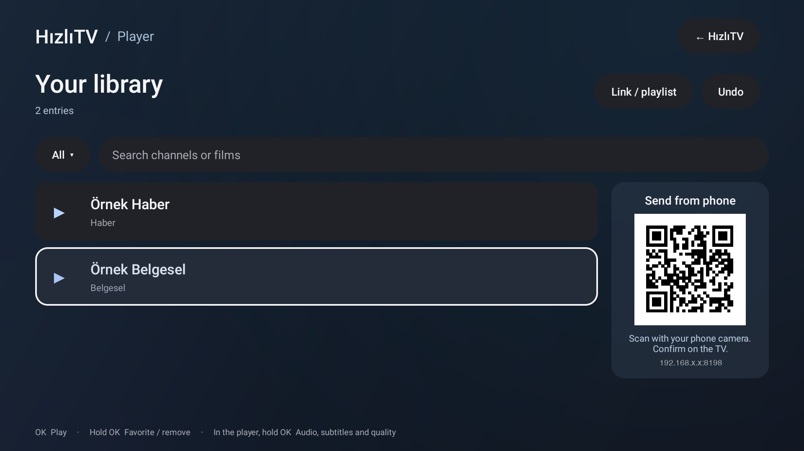

# Remote-control usage

[English](USAGE.md) · [Türkçe](../KULLANIM.md)

Open HızlıTV in the stock TV app list. Directions move focus, OK opens a card, and holding OK pins/unpins an app. HOME stays assigned to the original launcher. Favorites sit on top and all installed apps follow below on the same screen. On remotes with a Menu key it jumps between the two; Back from all apps returns to Favorites, then leaves the app.

Four round icons beside the clock open an installed AirPlay receiver (hidden when none is installed), Memory, Android Settings and the stock home screen; the focused icon's name appears in the greeting panel. Player is the first favorite card. Memory opens app-memory diagnostics, where Free memory also lives; the RAM summary is shown in the greeting panel. The EN/TR button chooses the app language without changing the system language.

## Library

- **Send from phone panel:** the QR code stays visible beside the library; pairing is created automatically on first use. OK on the panel enlarges it and offers **New QR code**. Existing shortcuts do not need a new QR code unless addressing/pairing changed.
- **Link / playlist:** enter a direct link, supported web page, M3U URL or M3U text.
- **Undo:** shown only while an undo backup exists; reverts the most recent library edit (one level).
- **Show / Search:** Show picks All, Favorites or one group; search matches English/Turkish text.
- **OK on an entry:** play it directly (the library is your own list, so there is no extra prompt). Saved web-page entries are resolved again first. Links sent from a phone still ask on the TV.
- **Hold OK:** favorite or remove the entry.
- **HızlıTV:** return to the dashboard inside the same app.

Incoming links use the themed source prompt. Play starts playback; Add to library saves an entry; Cancel leaves it unchanged. Multiple sources are chosen before confirmation. Playlists have a separate Add playlist confirmation. No phone request automatically starts playback or saves a list.

## Video

The playback overlay shows the title, group/source, list position, a LIVE badge for live streams and the clock on top; a progress bar with remaining time and a key hint below. It hides after five seconds while playing and stays while paused.

| Key | Action |
| --- | --- |
| OK / Play-Pause | Play or pause (OK acts when released) |
| ◀ ▶ / Rewind, Fast-forward | Seek 10 s; holding speeds up to 30 s and 60 s steps (films only) |
| ▲ ▼ / CH−, CH+ | Previous/next entry of the list it was opened from (the current filter or search); repeated presses pick the target, playback switches when you stop |
| Hold OK / Menu / Info | Options: quality, audio, subtitles, subtitle size (remembered), picture (fit, zoom, stretch), speed (films only) and a sleep timer (15–90 min; pauses and asks, then closes after a minute without an answer). Holding OK works on remotes without a Menu key |
| Back | Hide the overlay, then leave playback |

A film with a saved position of at least one minute asks **Resume** or **Start over**; Back on that question resumes. If a stream that was already playing loses its connection, the player retries quietly up to three times before showing an error. Errors explain the likely cause (refused/expired link, no connection, unsupported format, copy protection) with Retry, Next (inside a list) and Back. Unsupported or missing tracks are not invented. Video surroundings are black; Fit keeps the aspect ratio and is the default, and the picture choice is remembered.

Volume keys control the device's media stream. The HDMI TV's volume can be a second, independent level. The app does not force volume on every start. A separate AirPlay receiver can affect system volume depending on its configuration; the supplied optional profiles disable sender-driven synchronization.

## Memory tools

RAM occupancy includes Android caching, so a high percentage alone is not a fault. Total/free RAM needs no DUMP permission. Detailed process data depends on optional diagnostics/usage access and Android behavior. A process listed in memory is not necessarily a foreground app.

Free memory (on the Memory screen) requests only Android-allowed cleanup, after the user chooses it. Android can restart apps and restrict cleanup on newer releases. Direct selected-app closure uses a separate explicit local-ADB consent/pairing flow. Do not grant it merely to play media. [Security](../../SECURITY.md) explains scope and undo.

## Phone and AirPlay

Keep the Player library visible when sending; its listener stops outside that screen, including during playback. The phone page uses English/Turkish browser negotiation and a language switcher. [Shortcuts](IPHONE.md) sends a URL rather than mirroring the entire phone screen.

AirPlay is independent: open the receiver from its shortcut, then use the Apple device's Screen Mirroring menu. See [receiver setup](../../airplay/README.md). Its own UI and permissions belong to the upstream app.
